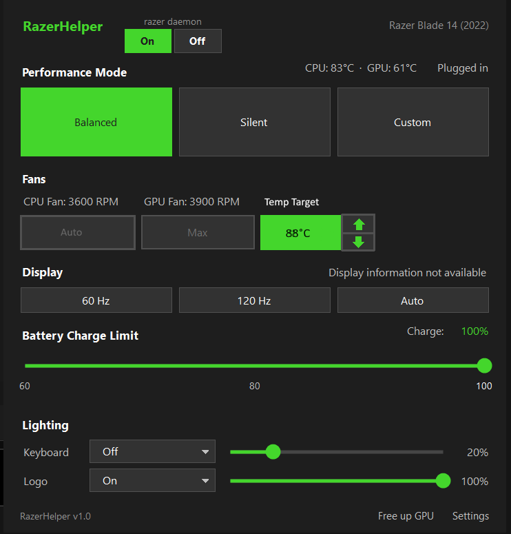
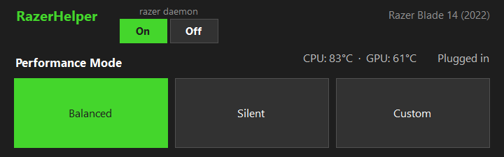
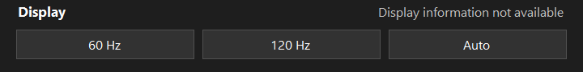
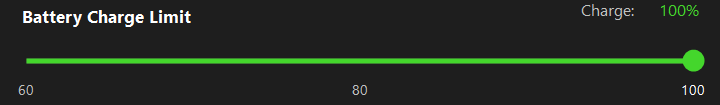
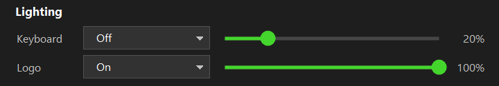
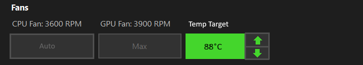

<p align="center">
  
</p>

<h1 align="center">RazerHelper</h1>

<p align="center">A small, open-source replacement for Razer Synapse on Razer Blade laptops.<br>
Lives in the system tray. No account, no cloud, no driver.</p>

<p align="center">
  
</p>

> **A fork** of [Paulrod20/razer-helper](https://github.com/Paulrod20/razer-helper) (MIT) with extras for the **Razer Blade 14 (2022)**: a razer daemon On/Off switch, Max fan speed in any mode, and a Temp Target fan mode. Not affiliated with Razer. **Use at your own risk** ([disclaimer](#disclaimer)).

## Features

- **Performance modes:** Balanced, Silent, Custom (with CPU/GPU boost), with separate plugged-in and battery profiles.
- **Fans:** live CPU and GPU RPM, plus **Auto**, **Max** and **Temp Target** (see below).
- **Display:** 60 Hz, 120 Hz, or Auto (follows the power source).
- **Battery charge limit:** 60 to 100 %.
- **Lighting:** keyboard effects and brightness, and the lid logo.
- **Razer daemon On/Off:** start and stop `razer-daemon.exe` (see below).
- **Free up GPU:** closes apps keeping the dedicated GPU awake, after asking you.
- **Razer services:** stop and restore Razer's background software with one button.
- **Fn+Del** shows or hides the window from any program, even a game.

<table>
  <tr>
    <td></td>
    <td><br></td>
  </tr>
  <tr>
    <td colspan="2"></td>
  </tr>
</table>

## New in this fork

### Razer daemon On / Off


If you run `razer-daemon.exe` from [Razer Blade Control](https://github.com/aiaiaioh/RazerBladeControl), two buttons at the top of the window start and stop it. The lit button shows whether it is running.

- **Off** asks the daemon to save and exit. **On** runs its `RazerDaemon` scheduled task. Neither needs an admin prompt. With no task, **On** starts the exe directly and Windows asks for approval.
- The buttons only appear if the daemon is installed or running.

<br clear="right">

### Fan modes

<p align="center">
  
</p>

Only the active mode is green.

| Mode | What it does |
| --- | --- |
| **Auto** | The laptop runs the fans. |
| **Max** | Both fans at full speed (5000 RPM on the Blade 14 (2022)), in any performance mode, plugged in or on battery. |
| **Temp Target** | Steers the fans to hold the **hotter of the CPU and GPU** at your chosen temperature. |

**Temp Target:** click the box to turn it on, and use the arrows to change the target by 1 °C (60 to 90 °C, default 85 °C).

- Well under the target the fans stay on Auto. Within 2 °C of it, the app takes over at the slowest speed it can hold (3500 RPM here), speeds up the further over you go, and slows down gradually when under. At the slowest speed and 5 °C under, it hands back to Auto.
- 5 °C over the target, or **92 °C at any target**, goes flat out.
- It adjusts every 3 seconds, **even with the window closed**, and only while Temp Target is on.
- Not available in Custom mode, where the laptop runs its own fans.
- The CPU reading comes from a sensor in the laptop's controller. It is slower than, and reads lower than, tools that read the CPU die.

**Safety:** if it loses the temperature readings or cannot adjust the fans, it hands them back to Auto and says why in red at the top of the window. Changing performance mode or quitting the app also returns them to Auto, and the app always starts on Auto. If it crashes or is killed, the fans stay at their last speed until you restart it or change performance mode.

## Install

Needs **Windows 11** and the [.NET 10 Desktop Runtime](https://dotnet.microsoft.com/download/dotnet/10.0) (".NET Desktop Runtime", x64). Get the files from the [Releases](../../releases) page:

- **Installer:** `RazerHelper-Setup-<version>.exe`. Installs for your user only, no admin rights. Start it from the Start menu, then use the tray icon or **Fn+Del**.
- **Portable:** `RazerHelper-<version>-portable.zip`. Unzip and run `RazerHelper.exe`. The `-selfcontained` zip includes .NET.

The app is not code-signed, so SmartScreen may warn: click **More info**, then **Run anyway**. Settings live in `%LOCALAPPDATA%\RazerHelper`.

## Supported laptops

| Model | USB product ID | Status |
| --- | --- | --- |
| Razer Blade 16 (2023) | `0x029F` | Verified by the original author |
| **Razer Blade 14 (2022)** | `0x028C` | **Added in this fork; reported working by its owner, not independently verified** |
| Razer Blade 15 (2022), 14 (2023), 16 (2024), 16 (2025), 15 Base (2020) | `0x028A`, `0x029D`, `0x02B7`, `0x02C6`, `0x0255` | Community-reported IDs only |

Unverified models run the same commands as the verified one; an unsupported command just fails. If something looks wrong, open an issue with the log (Settings > "Open log folder"). Max and Temp Target use a manual fan command taken from the Razer Blade Control daemon, which uses it on the Blade 14 (2022); it hasn't been checked on other models. Per-model fan speed limits come from that project's device table (the 2024 and 2025 Blade 16 use the 2023 figures as a guess).

## Build from source

Needs the [.NET 10 SDK](https://dotnet.microsoft.com/download/dotnet/10.0).

```
git clone https://github.com/<your-username>/razer-helper.git
cd razer-helper/src/RazerHelper
dotnet run
```

Tests use a fake laptop (`cd src/RazerHelper.Tests`, then `dotnet test`). To build the installer and portable zip, run `.\package.ps1 -Version 1.1.0` from the repo root in PowerShell (needs [Inno Setup](https://jrsoftware.org/isinfo.php) 6 or 7; add `-SelfContained` to bundle .NET in the zip; if Windows blocks the script, run `Set-ExecutionPolicy -Scope Process -ExecutionPolicy Bypass` first). Output goes to `dist\`.

## Razer Synapse

When Razer's software is installed, a row at the bottom shows how many of its services are running, with **Stop** (stops the services, turns off their startup, asks its programs to close) and **Start** (restores everything exactly as it was). Nothing is force-closed or deleted. Uninstalling Synapse is the cleanest option but also removes setup for Razer mice, keyboards and headsets, and this app has only been tested with Synapse installed.

## How it works

Commands go to the laptop's embedded controller over a standard Windows HID interface, with no third-party HID library. Writes are checked: the controller echoes what it accepted, and anything else counts as a failure. The daemon buttons talk to `razer-daemon.exe` on its local port (`127.0.0.1:29494`).

## Credits

- [Paulrod20/razer-helper](https://github.com/Paulrod20/razer-helper) by Paul Rodriguez (MIT): the original app. Its tray and exe icon is by [jdsgnrinfo](https://github.com/jdsgnrinfo).
- [razer-control-win](https://github.com/Kraven1109/razer-control-win) by Kraven1109 and its Blade 14 fork [Razer Blade Control](https://github.com/aiaiaioh/RazerBladeControl): the daemon, the manual fan command and the fan limits.
- [razer-ctl](https://github.com/tdakhran/razer-ctl) by tdakhran and [sqmagellan/razer-ctl](https://github.com/sqmagellan/razer-ctl) (MIT): the documented Blade command set.
- [OpenRazer](https://github.com/openrazer/openrazer) and [G-Helper](https://github.com/seerge/g-helper): the protocol work and inspiration. No G-Helper code is used.

## Disclaimer

This app writes to the laptop's embedded controller, **can hold the fans at a fixed speed**, and can stop Windows services. The original commands were verified on a Blade 16 (2023); the Blade 14 (2022) support and manual fan control here are less tested. **You use it at your own risk.**

It is provided "as is", without warranty. **The authors are not responsible for anything that breaks, stops working or is lost as a result of using it**, including damage to your laptop, changes to performance, battery or thermal behavior (including overheating or fan noise), problems with Razer software or devices, or data loss. This is a plain-language reminder of the no-warranty terms in the [MIT license](LICENSE). If that isn't acceptable, please don't use the app.

Razer, the Razer logo, Razer Synapse and Blade are trademarks of Razer Inc., used only to say what this works with. RazerHelper is independent and is not made, endorsed or supported by Razer.

## License

[MIT](LICENSE)
